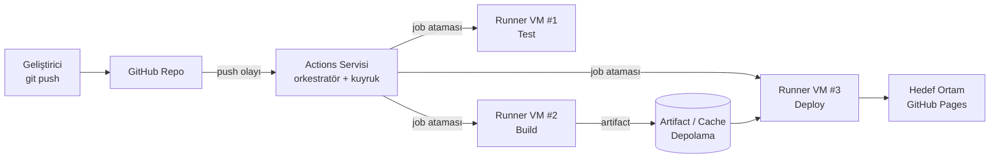

# Bulut Tabanlı CI/CD'nin Teknik Altyapısı (GitHub Actions Örneği)

> `git push` dediğimiz anda, perde arkasında hangi sistemler çalışıyor, kod hangi makinede test ediliyor, o makineler nerede duruyor ve iş bitince ne oluyor?

---

## 1. Büyük Resim: Bileşenler

Bir GitHub Actions pipeline'ı üç ana parçadan oluşur:

| Bileşen | Görevi | Nerede çalışır? |
|---|---|---|
| **GitHub (olay kaynağı)** | Push, pull request gibi olayları üretir | GitHub sunucuları |
| **Actions servisi (orkestratör)** | Workflow dosyasını okur, job'ları sıraya koyar, makinelere dağıtır, logları toplar | GitHub'ın bulut altyapısı |
| **Runner (çalıştırıcı makine)** | Job'daki komutları (`npm ci`, `npm test`…) fiilen çalıştırır | Microsoft Azure veri merkezlerindeki sanal makineler *veya* kendi sunucunuz |



---

## 2. Adım Adım: Push'tan Sonra Ne Oluyor?

1. **Olay oluşur.** `git push` ile kod GitHub'a ulaşır, GitHub bir `push` olayı (event) üretir.
2. **Workflow eşleştirilir.** Actions servisi repodaki `.github/workflows/*.yml` dosyalarını tarar ve `on: push` koşulu tutan workflow'ları bulur.
3. **Job grafiği çıkarılır.** `needs:` ifadelerinden bir bağımlılık grafiği (DAG) oluşturulur:
   `test → build → deploy`. Bağımlılığı olmayan job'lar paralel çalışabilir.
4. **Kuyruğa alınır.** Her job, `runs-on: ubuntu-latest` etiketine uyan bir runner beklemek üzere kuyruğa girer.
5. **Makine tahsis edilir.** GitHub, Azure üzerinde **sıfırdan, temiz bir sanal makine** ayağa kaldırır (veya hazır havuzdan bir tane verir).
6. **Runner bağlanır.** VM içindeki *runner uygulaması* GitHub'a bağlanır, job tanımını ve kısa ömürlü erişim anahtarlarını alır.
7. **Adımlar çalışır.** `checkout`, `setup-node`, `npm ci`, `npm test`… sırayla çalıştırılır. Çıktılar canlı olarak GitHub arayüzüne aktarılır (log streaming).
8. **Sonuç raporlanır.** Her adımın çıkış kodu kontrol edilir; biri `0` dışında dönerse job **başarısız** olur ve ona bağlı job'lar çalışmaz.
9. **Makine yok edilir.** Job biter bitmez VM silinir. Diskteki her şey (kod, `node_modules`, build çıktısı) kaybolur.

> Bizim pipeline'ımızda bu, **3 ayrı job = 3 ayrı sanal makine** anlamına gelir.

---

## 3. Runner'lar: Kod Nerede Çalışıyor?

### 3.1 GitHub-Hosted Runner (bizim kullandığımız)

- **Fiziksel konum:** GitHub, Microsoft'a aittir; Linux ve Windows runner'ları **Microsoft Azure** veri merkezlerinde sanal makine olarak çalışır. macOS runner'ları ise Apple lisans gereği Apple donanımı üzerinde çalışır.
- **Geçici (ephemeral):** Her job için yeni bir VM açılır, job bitince yok edilir. Bir önceki çalıştırmadan hiçbir iz kalmaz. Bu, hem **güvenlik** (başka bir projenin kodu/şifresi sızmaz) hem de **tekrarlanabilirlik** ("benim makinemde çalışıyordu" sorununu ortadan kaldırır) sağlar.
- **İzolasyon:** Her job kendi sanal makinesindedir, yani başka kullanıcıların job'larıyla aynı işletim sistemini paylaşmaz. İzolasyonu hypervisor (sanallaştırma katmanı) sağlar.
- **Tipik donanım (standart Linux runner):** public repolarda yaklaşık **4 vCPU, 16 GB RAM, 14 GB SSD**; private repolarda daha küçük makineler verilir. Daha güçlü makineler için ücretli *larger runner* seçenekleri vardır. Güncel değerler: [GitHub-hosted runners](https://docs.github.com/en/actions/using-github-hosted-runners/about-github-hosted-runners).
- **Hazır imaj:** `ubuntu-latest` boş bir Ubuntu değildir. İçinde Node.js, Python, Java, Docker, Git, çeşitli CLI'lar gibi yüzlerce araç önceden kurulu gelir. Bu imajlar açık kaynaktır ve [actions/runner-images](https://github.com/actions/runner-images) reposunda tanımlanır, düzenli olarak (genelde haftalık) güncellenir.

### 3.2 Runner Uygulaması

Her VM'in içinde **runner** adlı açık kaynak bir ajan programı çalışır ([actions/runner](https://github.com/actions/runner)).

- GitHub'a **giden (outbound) HTTPS bağlantısı** kurar ve "bana iş var mı?" diye sorar (long polling). Dışarıdan makineye bağlantı açılması gerekmez. Bu yüzden runner'lar güvenlik duvarı arkasında bile çalışabilir.
- Gelen job'ı adım adım yürütür, logları ve sonuçları geri gönderir.
- Azure DevOps'un (Azure Pipelines) ajanından türetilmiştir; iki ürün aynı altyapı mirasını paylaşır.

### 3.3 Self-Hosted Runner

Aynı runner uygulamasını **kendi makinenize** kurarak da job çalıştırabilirsiniz:

| | GitHub-Hosted | Self-Hosted |
|---|---|---|
| Makine kimde? | GitHub / Azure | Sizde (ofis sunucusu, AWS EC2, kendi veri merkeziniz…) |
| Bakım | GitHub yapar | Siz yaparsınız |
| Ortam | Her job'da sıfırdan | Varsayılan olarak kalıcı (temizliği siz yönetirsiniz) |
| Maliyet | Dakika bazlı (public repo ücretsiz) | Makine maliyeti sizde, GitHub dakika ücreti yok |
| Ne zaman? | Çoğu proje | Özel donanım (GPU), iç ağdaki sistemlere erişim, yüksek hacim |

Büyük kurumlarda self-hosted runner'lar genellikle **Kubernetes** üzerinde, ihtiyaca göre otomatik çoğalıp azalan pod'lar olarak çalıştırılır (Actions Runner Controller - ARC).

---

## 4. Job'lar Arası Veri: Artifact ve Cache

Her job ayrı ve geçici bir makinede çalıştığı için, **bir job'ın diskindeki dosyalar diğerine kendiliğinden geçmez.** Bizim pipeline'ımızda her job'ın `npm ci`'yi yeniden çalıştırmasının sebebi budur.

Veriyi taşımak için GitHub'ın yönettiği bulut depolama kullanılır:

| Mekanizma | Ne için? | Bizim pipeline'da |
|---|---|---|
| **Artifact** | Bir job'ın *ürettiği* çıktıyı sonraki job'a veya insanlara aktarmak | Build job'ı `dist/` klasörünü yükler (`upload-pages-artifact`), Deploy job'ı onu alır |
| **Cache** | Sık değişmeyen dosyaları (bağımlılıklar) tekrar indirmemek | `setup-node` içindeki `cache: npm`; npm paketleri `package-lock.json`'a göre önbelleğe alınır |

- Artifact'lar varsayılan olarak bir süre (genelde 90 gün) saklanır ve sonra silinir.
- Cache'in repo başına bir boyut sınırı vardır; uzun süre kullanılmayan kayıtlar otomatik silinir.

---

## 5. Güvenlik Altyapısı: Kimlik ve Yetkiler

### 5.1 `GITHUB_TOKEN`
Her job başladığında GitHub, o job'a özel **otomatik bir erişim anahtarı** üretir. Bu anahtar:
- Sadece o repoya erişebilir,
- Yetkileri workflow'daki `permissions:` bloğuyla sınırlandırılır,
- Job bitince geçersiz olur.

Bizim workflow'da `contents: read` ile kodu sadece okuma izni verdik.

### 5.2 Secrets
API anahtarı, bulut şifresi gibi gizli değerler repo ayarlarında **şifrelenmiş** olarak saklanır, yalnızca job çalışırken runner'a verilir ve loglarda otomatik olarak `***` şeklinde maskelenir.

### 5.3 OIDC: Şifresiz Bulut Erişimi
Workflow'daki `id-token: write` izni **OpenID Connect (OIDC)** içindir:
1. Job, GitHub'dan "ben şu repo'nun, şu branch'teki workflow'uyum" diyen **imzalı, kısa ömürlü bir kimlik belgesi** (JWT) ister.
2. Hedef sistem (GitHub Pages, AWS, Azure, Google Cloud) bu belgeyi doğrular ve geçici erişim verir.
3. Hiçbir yerde kalıcı bir şifre saklanmaz.

Bizim Deploy job'ı GitHub Pages'e bu yöntemle yetkilendiriliyor. Aynı mekanizma AWS/Azure/GCP'ye deploy ederken de kullanılır ve modern bulut CI/CD'de önerilen yöntemdir.

---

## 6. "Action"lar Nedir, Nereden Geliyor?

Workflow'daki `uses: actions/checkout@v4` satırı, başka bir GitHub reposundaki hazır bir programı çağırır:

- `actions/checkout@v4` → `github.com/actions/checkout` reposunun `v4` sürümü.
- Runner, job başlarken bu action'ları indirir ve çalıştırır.
- Action türleri: **JavaScript** (doğrudan Node.js ile çalışır), **Docker container** (kendi imajında çalışır), **Composite** (birkaç adımı paketler).
- GitHub Marketplace'te on binlerce hazır action bulunur. Güvenlik açısından sürümü sabitlemek (`@v4` veya commit hash) önemlidir.

---

## 7. Sınırlar ve Maliyet Modeli

| Konu | Değer (yaklaşık; güncel değerler GitHub dokümanında) |
|---|---|
| Public repolar | GitHub-hosted runner kullanımı **ücretsiz** |
| Private repolar | Plana göre aylık ücretsiz dakika kotası, sonrası dakika başı ücret |
| İşletim sistemi çarpanı | Linux en ucuz; Windows ve macOS dakikaları daha pahalı |
| Tek job süresi | En fazla 6 saat (GitHub-hosted) |
| Eşzamanlı job | Plana göre sınırlı (ücretsiz planda ~20) |

Bu **"kullandığın kadar öde"** modeli, bulutun DevOps'a sağladığı maliyet avantajının somut bir örneğidir: CI sunucusu satın almak, kurmak ve bakımını yapmak gerekmez.

---

## 8. Diğer Platformlarda Aynı Altyapı

Kavramlar tüm platformlarda aynıdır, sadece isimler değişir:

| Kavram | GitHub Actions | GitLab CI | Jenkins | Azure DevOps | AWS CodePipeline |
|---|---|---|---|---|---|
| Pipeline tanımı | `.github/workflows/*.yml` | `.gitlab-ci.yml` | `Jenkinsfile` | `azure-pipelines.yml` | Konsol / CloudFormation + `buildspec.yml` |
| Orkestratör | Actions servisi | GitLab sunucusu | Jenkins Controller | Azure DevOps servisi | CodePipeline |
| Çalıştırıcı | Runner | Runner | Agent | Agent | CodeBuild (container) |
| Makineler nerede? | Azure VM / kendi makinen | GitLab bulutu / kendi makinen | Tamamen kendi altyapın | Azure VM / kendi makinen | AWS (EC2 / container) |

En büyük fark **Jenkins**'tedir: tamamen kendi sunucunuzda kurulur, yani orkestratör dahil her şeyin bakımı sizdedir. Diğerleri yönetilen (managed) bulut servisleridir.

---

## 9. Docker ve Kubernetes'in Yeri

- **Docker:** Job'lar bir container içinde çalıştırılabilir (`container: node:20`), bu da ortamı birebir sabitler. Pipeline'ın çıktısı da çoğu zaman bir Docker imajıdır: build aşamasında imaj üretilir, bir **container registry**'ye (GitHub Container Registry, Docker Hub, AWS ECR) gönderilir.
- **Kubernetes:** Deploy aşamasında bu imaj bir Kubernetes kümesinde (AWS EKS, Azure AKS, Google GKE) çalıştırılır. Ayrıca, yukarıda anlatıldığı gibi, self-hosted runner'ların kendisi de Kubernetes üzerinde ölçeklenebilir.

Tipik kurumsal akış:

```
git push → CI (test + Docker imajı build) → Registry → CD (Kubernetes'e deploy) → Kullanıcılar
```

---

## 10. Özet

- CI/CD işleri, **bulutta isteğe göre açılan ve iş bitince yok edilen geçici sanal makinelerde** çalışır. GitHub Actions için bunlar Microsoft Azure veri merkezlerindedir.
- **Orkestratör** (Actions servisi) olayları dinler, job'ları sıraya koyar ve makinelere dağıtır. **Runner** ise komutları fiilen çalıştırır.
- Her job **izole ve temiz** bir ortamdır. Veri job'lar arasında **artifact** ve **cache** ile, GitHub'ın bulut depolaması üzerinden taşınır.
- Güvenlik, **kısa ömürlü token'lar**, **şifrelenmiş secret'lar** ve **OIDC** ile sağlanır; kalıcı şifrelere gerek kalmaz.
- İstenirse aynı sistem **kendi sunucularımızda** (self-hosted) veya **Kubernetes** üzerinde de çalıştırılabilir.
